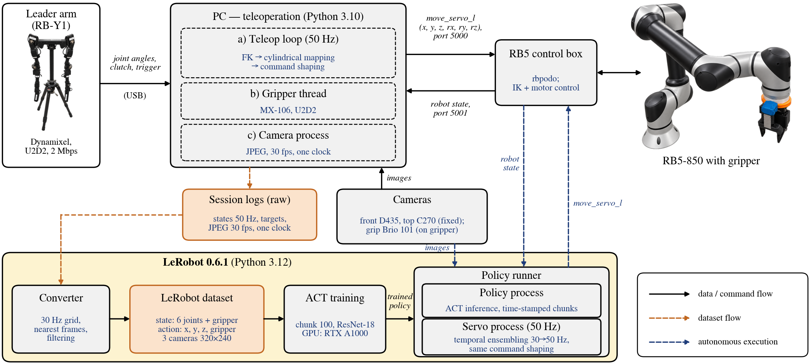

# Task-Space Imitation Learning for Robotic Lunchbox Packing

A Rainbow Robotics RB5-850 learns to pack a lunchbox from demonstrations given with a kinematically different
leader arm (RB-Y1, seven joints). The policy puts a model carrot into a black box, then an Oreo into the large
hole and a RITZ into the small hole of a meal box, in that order, from three RGB cameras.


https://github.com/user-attachments/assets/d778df4a-8371-4b7f-bb88-9b9d124799c1


*Autonomous runs at 2x speed: a successful trial, a missed grasp followed by a re-grasp, and a failure in which
the fingertips flick the carrot away. The evaluation (30 trials over six item layouts) is reported in the paper.*

<!-- Time-lapse: drag data/media/collection_timelapse.mp4 (33 s, 3.3 MB) onto the empty line below in the GitHub
     web editor, then delete this comment. -->

*Demonstration collection (time-lapse): the operator behind the table teleoperates the RB5 with the leader arm
while the three cameras record.*

## System



- **Teleoperation.** The leader arm is only read. Forward kinematics gives its wrist position, which is mapped,
  relative to a clutch press, to the RB5 tool position in cylindrical coordinates about the robot base axis
  (forward and back move along the arm, up and down change the height, a mode button turns the base). The
  gripper follows an analog trigger.
- **One command path.** Teleoperation targets and policy actions pass through the same command shaping
  (workspace, speed, singularity and joint limits, acceleration) and are streamed to the controller with
  `move_servo_l` at 50 Hz. The recorded action is the shaped target the robot executed.
- **Learning.** Robot states, targets, and the three camera streams share one clock; a converter builds a
  LeRobot dataset, and an ACT policy predicts Cartesian position targets and gripper commands. At run time,
  chunks are combined by time in a separate 50 Hz servo process.

**Hardware:** RB5-850 (control box 8.4.4), RB-Y1 leader arm (Dynamixel, U2D2), in-house 3D-printed parallel
gripper (Dynamixel MX-106), cameras RealSense D435 (front), Logitech C270 (top), Logitech Brio 101 (grip),
a Linux laptop with an NVIDIA RTX A1000.

## Usage

Two conda environments: `rb5` (teleoperation, recording; `environment.yml`) and `lerobot` (LeRobot 0.6.1;
`environment_lerobot.yml`). Linux only.

```bash
python -m teleop --real --record                       # env rb5: demonstrations -> data/demos/<session>/
python -m rb5_lerobot.convert SESSION ... --name NAME  # env lerobot: -> LeRobot dataset
python -m rb5_lerobot.train NAME                       # ACT training
python -m rb5_lerobot.check TRAINING                   # offline check on recorded episodes
python -m rb5_lerobot.run TRAINING [--real]            # the policy drives the robot
```

Without `--real`, the robot runs in the controller's simulation mode. Read
`docs/real_first_run_checklist.md` before any real-robot run; the command shaping is not collision avoidance.

Guides: `docs/pipeline_guide.md` (demonstrations to policy runs), `docs/teleop_guide.md`,
`docs/data_rules.md` (how demonstrations and the evaluation were done), `docs/hardware.md`.

## Repository

- `teleop/` leader arm to RB5 teleoperation, recording; `rb5_lerobot/` dataset, training, policy runs
- `configs/` teleoperation (`real.yaml`, `sim.yaml`), learning and policy runs (`policy.yaml`), evaluation layouts
- `scripts/` numbered test and analysis scripts (`scripts/README.md`); `tests/` unit tests with fake devices
- `assets/` leader arm URDF (from rby1-sdk, Apache 2.0, see its LICENSE and NOTICE) and udev rules

The robot and leader arm images in the architecture figure were generated with ChatGPT (OpenAI, gpt-image)
from photographs of our hardware.

## License

MIT (see `LICENSE`), except `assets/leader_arm/`, which keeps its Apache 2.0 license and NOTICE.
